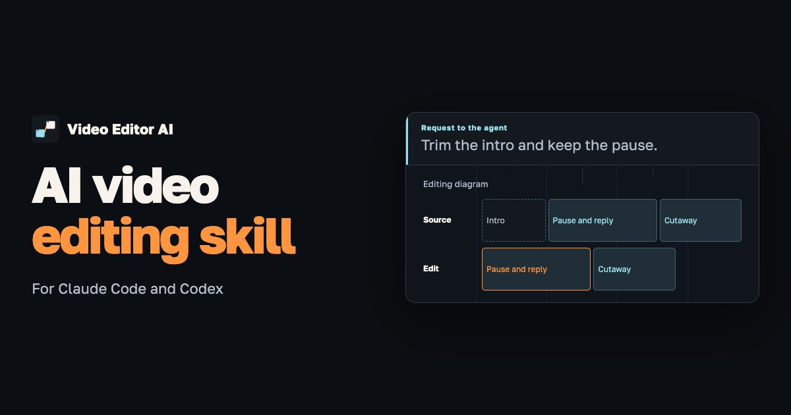

# Video Editor AI



An AI video editing skill for Claude Code and Codex. Review footage, decide what to reshoot, plan a cut with source timecodes, refine captions, and export locally with FFmpeg.

**ИИ-видеомонтажёр для Claude Code и Codex.** Разбирает исходники, предлагает склейки с таймкодами и помогает собрать ролик локально.

**适用于 Claude Code 和 Codex 的 AI 视频剪辑技能。** 检查素材，制定带时间码的剪辑方案，并使用 FFmpeg 在本地导出。

[Русский](https://bearatol.github.io/video-editor-ai/) · [English](https://bearatol.github.io/video-editor-ai/en/) · [简体中文](https://bearatol.github.io/video-editor-ai/zh/) · [skills.sh](https://skills.sh/bearatol/video-editor-ai/video-editor)

## Install

### In the app

- **Claude Code Desktop.** Open a local project. If the plugin browser offers a way to add a source, enter `bearatol/video-editor-ai`. Alternatively, use a text editor to merge the JSON below into the project's `.claude/settings.json`, preserve existing settings, and reopen the trusted project. Select **+ → Add plugins** or **Plugins → Browse plugins**, select the **Video Editor AI** source, then open **Video Editor AI** and select **Install**. [Claude Code Desktop guide](https://code.claude.com/docs/en/desktop#install-plugins)
- **Codex Desktop.** Use GitHub Desktop to clone [this repository](https://github.com/bearatol/video-editor-ai) and open it as a Codex project. Restart Codex, open **Plugins**, choose the **Video Editor AI** source, and install the plugin for that project. The source is declared in the repository's `.agents/plugins/marketplace.json`. [Codex plugin guide](https://developers.openai.com/plugins/build/plugins#build-your-own-curated-plugin-list)
- **Claude in your browser.** [Download the standalone skill ZIP](https://bearatol.github.io/video-editor-ai/assets/video-editor-skill.zip). Open **Customize → Skills → Create skill → Upload a skill** and upload it. Availability depends on your account's skills settings. Local export requires an environment with access to the clips and FFmpeg. [Claude skills guide](https://support.claude.com/en/articles/12512180-use-skills-in-claude)

```json
{
  "extraKnownMarketplaces": {
    "video-editor-ai-plugins": {
      "source": {
        "source": "github",
        "repo": "bearatol/video-editor-ai",
        "ref": "v0.1.1"
      }
    }
  }
}
```

### Ask your agent

Paste into a local Claude Code or Codex session that can access the project and use tools.

> Install Video Editor AI from https://github.com/bearatol/video-editor-ai for this project. Read the project's official installation guide, use the method supported here, and verify that the video-editor skill is available. Ask me if the environment requires approval. Leave FFmpeg installation for a separate request.

### Microsoft APM

With [APM](https://microsoft.github.io/apm/getting-started/installation/) installed, run this from the project directory. This installs the skill for Claude Code and Codex and pins a release in `apm.lock.yaml`.

```sh
apm install bearatol/video-editor-ai/plugins/video-editor-ai#v0.1.1 --target claude,codex
```

### skills.sh

With Node.js 22.20 or later, run this from the project directory and choose your agent in the installer. This installs the standalone `video-editor` skill.

```sh
npx skills@1.9.0 add bearatol/video-editor-ai --skill video-editor
```

### Native commands

In a Claude Code conversation:

```text
/plugin marketplace add bearatol/video-editor-ai
/plugin install video-editor-ai@video-editor-ai-plugins
```

For Codex CLI with plugin support:

```sh
codex plugin marketplace add bearatol/video-editor-ai --ref main
codex plugin add video-editor-ai@video-editor-ai-plugins
```

After installation, open a fresh session and select `video-editor`. The native Claude Code plugin adds `/video-editor-ai:video-editor`.

## Example requests

[Guide in English, Russian, and Chinese](GUIDE.md) · [Fictional editing dialogues](EXAMPLES.md)

- Review this interview and tell me which sections to keep, trim, or reshoot.
- Plan a 45-second vertical cut. Give me source in/out timecodes and caption cues.
- Export the approved cut locally at 1080 × 1920. Preserve the original clips.

## Local export

The skill uses FFmpeg and ffprobe for inspection and export. If they are unavailable, it can still review accessible footage or draft a timecoded cut plan. If you explicitly ask it to install FFmpeg, it can use an existing supported package manager within the host's permissions. The skill package ships without executable scripts.

Use footage and transcripts you are authorized to share. Media used for local export stays in the agent's execution environment. The host app handles session data. See the [privacy section](https://bearatol.github.io/video-editor-ai/#privacy).

## Migrating from CEO AI

The former `ceo-ai:video-editor` skill now lives here. Use `video-editor-ai:video-editor` for video work. Your existing media and editing projects can be used with the new skill.

## License

[MIT](LICENSE). The skill is extracted from the MIT-licensed CEO AI release 0.10.4.
